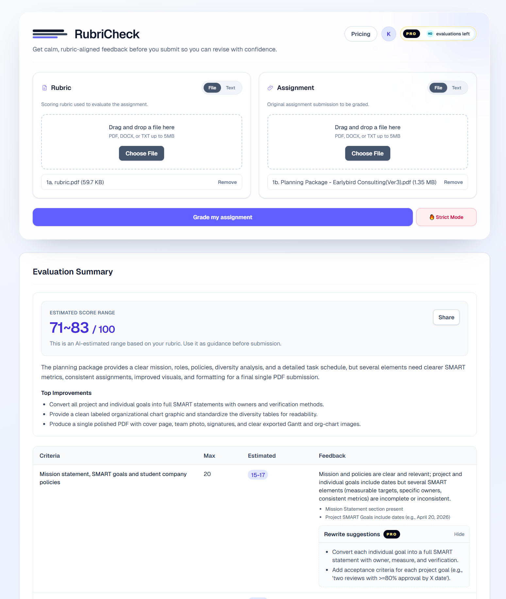

  

<h1 align="center">RubriCheck</h1>

  AI rubric grading assistant for students, tutors, and educators.

  Turn a rubric and an assignment draft into structured scoring criteria, estimated score ranges, and clear revision priorities.

  <a href="https://rubricheck.com"><strong>Visit rubricheck.com</strong></a>

  

## Overview

RubriCheck is a web product that helps users review assignment drafts before final submission.

Instead of manually comparing a paper against a long rubric, users can upload or paste both the rubric and the assignment. RubriCheck then structures the rubric, evaluates the draft criterion by criterion, estimates a score range, and highlights the most important next revisions.

This project was also built as a portfolio piece: not just a UI demo, but an end-to-end AI product with real input handling, rate limits, monetization flows, and production-oriented guardrails.

## Why It Matters

- Rubrics are often long, inconsistent, and difficult to use for self-review.
- Students want fast, actionable feedback before submission.
- Educators and tutors need a lightweight way to preview rubric alignment without manually scoring every draft.

RubriCheck focuses on practical feedback:

- structured rubric criteria
- criterion-level score estimates
- concise feedback per criterion
- top improvement priorities
- optional Pro flows for deeper usage

## Core Experience

### 1. Submit rubric and assignment

Users can:

- upload `PDF`, `DOCX`, `TXT`, `PNG`, `JPG`, or `JPEG`
- paste rubric text directly
- paste assignment text directly

### 2. Convert rubric into structured criteria

The app turns messy rubric text into a machine-readable grading structure so later evaluation can be consistent and predictable.

### 3. Evaluate the draft against the rubric

RubriCheck returns:

- overall estimated score range
- criterion-by-criterion feedback
- evidence-aware reasoning
- top 3 revision priorities

### 4. Share and iterate

Users can review the result, export a shareable summary image, and revise before submitting their real assignment.

## Product Highlights

- AI-assisted rubric structuring and draft evaluation
- Standard mode and Strict mode for different grading expectations
- File parsing pipeline for `PDF`, `DOCX`, `TXT`, and image OCR (`PNG`, `JPG`, `JPEG`)
- Usage limiting with Upstash Redis
- Pro / paid feature surface for rewrite and expanded access
- Stripe checkout and entitlement recovery flow
- Shareable results image generation

## Tech Stack

RubriCheck was designed as a practical SaaS-style AI product rather than a prototype.

- Frontend: `Next.js App Router`, `React 19`, `TypeScript`, `Tailwind CSS 4`
- Backend: `Next.js Route Handlers`
- AI integration: `OpenAI API`
- Validation: `Zod`
- File parsing: `pdf-parse`, `mammoth`, `Google Cloud Vision OCR` (image inputs)
- Billing: `Stripe`
- Rate limiting and lightweight session data: `Upstash Redis`
- Data / billing ledger: `Supabase Postgres`
- Deployment and monitoring: `Vercel Analytics`, `Vercel Speed Insights`

## Environment

- `OPENAI_API_KEY`: API key for rubric structuring, grading, and rewrite suggestions
- `STRUCTURE_MODEL=gpt-6-luna`: rubric structuring, with `reasoning.effort=low`
- `EVALUATION_MODEL=gpt-6-luna`: Standard/Strict grading (including guest previews) and rewrite suggestions, with `reasoning.effort=medium`
- `GOOGLE_CLOUD_VISION_API_KEY`: API key for Google Vision OCR
- `GOOGLE_VISION_LANGUAGE_HINTS` (optional): comma-separated OCR language hints (default: `en,ko`)

Set both model variables in `.env.local` and in the deployment environment. Restart
the local server or redeploy after changing them; `.env.local` is not committed.
Reasoning effort is set explicitly by workload in `lib/openai.ts`.

## What This Project Demonstrates

As a portfolio project, RubriCheck shows experience across both product thinking and implementation:

- turning an education workflow into a focused SaaS product
- designing AI output around structured, usable results instead of raw generation
- handling real-world edge cases like file validation, usage limits, and entitlement restoration
- connecting product UX with billing, access control, and deployment concerns
- building a clean end-to-end flow from landing page to evaluation result

## System Flow

1. User submits a rubric and assignment draft.
2. The server validates files and input size.
3. The rubric is converted into structured grading criteria.
4. The draft is evaluated against each criterion.
5. The response is normalized into score ranges, feedback, and improvement priorities.
6. The UI renders a result that is easy to review and share.

## Live Product

- Website: https://rubricheck.com

## Pro Lifetime

Pro Lifetime is a CAD $99.99 one-time purchase for ongoing Pro access. The pricing
control and checkout API are enabled and use the configured Stripe Price ID.
Checkout validates the amount, currency, one-time pricing, and active status before
opening a payment session. See [Stripe setup and activation](doc/pro-lifetime-stripe-setup.md).

## My rubrics and general criteria

Use **My rubrics** beside the rubric input to reopen recent rubrics, rename them,
or download their original files. Successful signed-in checks save up to 50 recent
rubrics per account using the existing Redis configuration.

Choose **No rubric** to grade with general criteria. Assignment instructions are
optional. The six existing guide pages, including the essay page, link directly
to these starting options. No new migration or environment variables are needed.

See [storage, behavior, and verification](doc/verification/rubric-library.md).
Run `npm run test:all` and `npm run test:rubrics:browser` for regression coverage.

## Free evaluation usage

Before deploying the reservation-based evaluation flow, apply `supabase/free_evaluate_reservations.sql` after the existing billing schema. See [deployment, behavior and verification](doc/free-evaluation-reservations.md).

## Assignment sidebar and projects

The home sidebar lists account-specific projects and recent evaluations. Search (Ctrl/Cmd+K)
finds assignments by title or project name. Projects group successive evaluated drafts; results
can be moved between projects, and deleting a project keeps its assignments in Recents.

History uses the existing Upstash Redis configuration (no SQL migration). Account namespaces
are derived from verified session emails. Results and project metadata have no automatic expiry;
raw rubric/assignment inputs retain the existing 24-hour recovery TTL (extended for checkout).
Only server-generated feedback is archived, with the original feedback access tier enforced.
The metadata hash is separate from result snapshots so listing history does not load full feedback.

New evaluations are archived automatically. A previously saved browser result is imported only
while its account-owned server recovery record is still available. Already expired evaluations
cannot be reconstructed. A history storage failure leaves the successful grading result usable
and displays a notice. Account data deletion must remove the account workspace hash and its
associated result keys in addition to other account data.

Validation: `npm run test:all` and `node scripts/check_assignment_workspace.mjs`.
The browser check uses mocked API responses; set `TEST_BASE_URL` for a local Next server and
`PLAYWRIGHT_MODULE` if Playwright is installed outside this repository.

## Product feedback

The home and pricing Feedback buttons open an in-app form for guests and signed-in users.
Messages are stored in the existing Upstash Redis instance (no migration or new environment variables).
The admin dashboard has a Feedback inbox with newest-first pages of 25, refresh, and retry.
Only existing admin sessions or the configured admin secret can read `/api/admin/feedback`.
Submission accepts up to 5,000 characters and an optional reply email; verified account identity
comes from the server session. Limits allow five messages per hour per account, or IP for guests.
The inbox key is `rubricheck:{feedback}:inbox`; messages have no automatic expiry. Account data
deletion must also remove matching feedback records. Query strings and raw IPs are not stored.
`NEXT_PUBLIC_FEEDBACK_URL` is no longer used.

Validation: `npm run test:all` and `node scripts/check_feedback_navigation.mjs` against a local
Next server (supports `TEST_BASE_URL` and `PLAYWRIGHT_MODULE`). Browser checks mock API responses.

## Guest samples and assignment previews

The home page offers a prepared sample (no AI request or quota use) and one guest
assignment preview. Guests can upload the existing supported file formats or paste
text, with a 20,000-character limit for each parsed input and Standard mode only.
The response includes only the Evaluation Summary; criterion feedback stays on the server.

Guest access requires the existing Upstash Redis configuration. No migration or new
environment variable is needed. Atomic reservations prevent concurrent checks,
release on failures, and fail closed when storage is unavailable. A random HttpOnly
cookie enforces one successful preview per browser for up to one year; a hashed IP
marker also limits the same network to one preview per 24 hours. Deploy behind a
trusted proxy that sets the client IP headers, as with the existing usage limits.
Shared-network visitors who reach this limit can sign up for their account checks.

Inputs and results expire after 24 hours. After email verification, the same browser
can claim the saved evaluation and view the existing Free-tier criterion feedback
without another model call or consuming account checks. The original Free/Top-up/Pro
detail restrictions still apply. Claiming is bound to one verified account and
supports retries. Account free usage, paid credits, and project evaluations keep
their existing billing paths.

Validation: `npm run test:all`, `npm run test:trial:browser`, and the existing
workspace, recovery, and feedback browser scripts. Browser tests use mocked API
responses; set `TEST_BASE_URL` for a local Next server and `PLAYWRIGHT_MODULE`
if Playwright is installed outside this repository.

## Node.js runtime security

Use Node.js **24.22.1 or a later stable 24.x release**. The October 21, 2026
security release fixes CVE-2026-111497 and other runtime vulnerabilities.
`.nvmrc` and `.node-version` select the patched release for local version managers.
Run `npm run check:runtime` after upgrading. Development, builds, production startup,
and Next.js server initialization reject unsupported runtimes. The server logs only
the verified Node.js version at initialization.

Vercel manages minor and patch updates within the selected `24.x` line. Redeploy
without the build cache after a security update and confirm
`NODE_RUNTIME_VERIFIED node=24.22.1` (or a later 24.x version) in both build and
runtime logs before rotating secrets. A package engine setting alone does not
prove that a deployed runtime is patched. See [runtime maintenance](doc/security/node-runtime.md).

## Actual scores and comments

Open a saved assignment and choose **Add actual score and comments** to record a grade,
instructor feedback or personal notes, and compare it with the original AI estimate.
Personal storage, optional quality validation, and optional anonymized public case use are
separate choices. Records can be edited or deleted and optional permissions withdrawn.
No extra checks, credits, SQL migration or new environment variables are required.

See [storage, consent, comparison and verification](doc/verification/actual-results.md).
Run `npm run test:all` and `npm run test:actual-results:browser` for regression coverage.

## Admin subscriber pagination

Before deploying the paginated admin dashboard, apply [supabase/admin_dashboard.sql](supabase/admin_dashboard.sql). See [deployment and verification](doc/admin-subscriber-pagination.md).

## Languages

English (`en`), Korean (`ko`) and Malay for Malaysia (`ms`) are available in the
sidebar account menu. Site language and the language used for new grading feedback
are saved independently to the authenticated account. Changing the language at the
top right of an existing result translates its visible feedback without changing
the original scores, saved result, usage balance or account preferences.

The existing Upstash Redis and OpenAI configuration is sufficient; there is no new
environment variable or database migration. Account defaults use
`rubricheck:preferences:<hashed-email>` without an expiry. Result translations are
cached per owner, original result and language for 24 hours, with up to 30 uncached
translation attempts per owner per hour. Include the preference key in account
data deletion procedures; transient translation keys expire automatically.

Public pages use the English canonical path, `/ko` and `/ms`, with server-rendered
translations, localized metadata, reciprocal hreflang links and sitemap entries.
Explicit public URLs keep their language even when the account or browser has a
different saved default. The neutral home URL (`/`) restores the saved site language;
the grading language is restored independently. Changing only the grading language
preserves the saved site default.
Add languages in `src/i18n`; English messages are the fallback. Grading evidence
quotes and user-supplied rubric names retain their original wording.

Validation: `npm run test:all`, `npm run build`, `npm run test:seo`, and
`npm run test:i18n:browser` against a local server. The browser test uses mocked
account and model responses and saves screenshots in `doc/verification/i18n`.
See [verification results](doc/verification/i18n/verification.json) and
[language-flow checks](doc/verification/i18n/results.json). Live model translation
quality and production account persistence require a deployment smoke test; the
automated runs isolate external services with fixtures and module mocks.

## Revenue and conversion measurement

See the [October 22 revenue audit and growth handoff](doc/growth/2026-10-22-revenue-growth.md)
for verified baseline figures, privacy-aware funnel measurement, the reversible
Credits/Pro comparison, SEO priorities, local verification, and the 7/14/30-day review plan.
First-party collection defaults off. The additive migration, daily retention job,
server configuration and production rollout require approval before enabling it.
