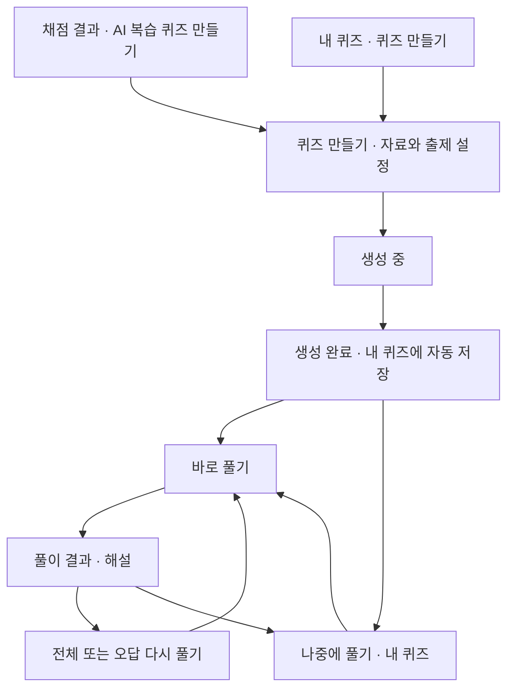

**RubriCheck 퀴즈 생성·학습 기능 최종 설계서**

작성일: 2026-11-03  
추가 요구사항 반영: 간결한 디자인·문구, 랜딩 페이지 기능 소개, 퀴즈 생성 검색 SEO.  
문서 상태: 개발 전 제품·화면·동작 명세. 이 문서 작성은 구현 또는 배포를 의미하지 않는다.  
적용 범위: RubriCheck. Quizeey 적용은 후속 작업으로 별도 진행한다.

**1. 채점한 과제와 사용자가 올린 학습 자료로 개인 복습 퀴즈를 만든다.**

채점 결과에서 해당 과제로 퀴즈를 만들거나, ‘내 퀴즈’에서 자료를 직접 올려 퀴즈를 만든다. 두 경로는 같은 생성·풀이·기록 기능을 사용한다. 채점하지 않은 과제도 입력할 수 있으며, 퀴즈 생성을 위해 채점을 먼저 받을 필요는 없다.

| 항목 | 확정 정책 |
|---|---|
| 제공 위치 | 별도 사이트 없이 RubriCheck 내부에 제공 |
| 생성 진입점 | 채점 결과의 ‘AI 복습 퀴즈 만들기’, 내 퀴즈의 ‘퀴즈 만들기’ |
| 자료 | 채점한 과제, 채점하지 않은 과제, 수업자료, 노트, 교과서, 붙여넣은 텍스트 |
| Guest | 퀴즈 생성 불가 |
| 일반 회원 | 계정당 누적 10문항 무료 생성. 월별 초기화 없음 |
| Pro | 월간·연간·평생 Pro 모두 전체 기능 이용, 월 생성량 제한 없음 |
| 문제 유형 | 4지선다와 O/X를 자료에 맞게 혼합. 서술형 없음 |
| 원문 만료 | 이미 생성한 퀴즈는 계속 이용. 만료된 원문으로 새로운 문제 생성 불가 |
| 복습 | 같은 문제 다시 풀기, 오답 다시 풀기에 생성량 차감 없음 |
| 요금 | 기존 요금제를 유지. 이번 범위에서는 별도 퀴즈 상품이나 생성 팩을 추가하지 않음 |
| 디자인 | 기존 서비스 스타일을 따르는 단순한 구성. 불필요한 설명·장식·중복 안내 제외 |
| 랜딩 페이지 | 퀴즈 생성 기능과 두 생성 경로를 짧게 소개하고 생성 화면으로 연결 |
| SEO | 공개 퀴즈 소개 페이지를 검색에 최적화. 개인 자료·생성한 퀴즈·풀이 기록은 검색 노출 제외 |

권한, 무료 10문항, Pro 월 한도 없음, 평생 Pro 동일 적용, 문제 유형, 원문 만료 후 동작은 사용자 결정이다. 문항 수 선택지·파일 크기·처리 분량 등 아래의 구체적인 운영 수치는 이 문서에서 정한 초기 설계 기본값이며, 구현 검증으로 조정할 수 있다. 이 수치로 Pro의 일별·월별 생성 총량 제한을 추가하지 않는다.

**2. 이용 권한과 무료 생성량을 다음과 같이 적용한다.**

| 사용자 상태 | 새로운 퀴즈 생성 | 저장된 퀴즈·해설·풀이 기록 |
|---|---|---|
| Guest | 로그인·가입 안내. 자료 처리와 AI 생성은 실행하지 않음 | 미리 준비된 샘플만 체험 가능 |
| 일반 회원 | 무료 잔여량 안에서 생성 | 계속 열람·풀이·복습 가능 |
| 활성 Pro: 월간·연간·평생 | 월 총량 제한 없이 생성 | 전체 이용 가능 |
| Pro 기간 종료 | 남아 있는 무료 체험량 안에서 생성 | Pro 때 만든 퀴즈도 계속 이용 가능 |
| 채점 크레딧만 구매한 회원 | 퀴즈에서는 일반 회원 정책 적용 | 계속 이용 가능 |

- 무료 10문항은 퀴즈 묶음 개수가 아니라 실제 생성된 개별 문항 수다. 4지선다와 O/X 모두 한 문항으로 계산한다.
- 채점 과제·파일 업로드·텍스트 붙여넣기는 동일한 무료 잔여량을 사용한다.
- 무료 이용 중 성공적으로 생성하고 계정에 저장한 문항만 차감한다. 검증에서 탈락한 문항, 중복 처리된 요청, 시스템 실패는 차감하지 않는다.
- 퀴즈를 삭제해도 무료 사용량은 복구하지 않는다. 이름 변경, 재풀이, 순서 변경, 저장된 해설 열람은 차감하지 않는다.
- 요청 수보다 적게 생성한 경우 저장된 실제 문항 수만 차감하고, 요청 수와 완료 수의 차이를 알린다. 자료가 부족하다는 이유로 부정확한 문제를 채워 넣지 않는다.
- 여러 창에서 동시에 요청해도 무료 10문항을 초과할 수 없다. 생성 중 예약된 문항 수는 사용 가능한 잔여량에서 제외하며, 실패한 예약은 해제한다.
- Pro 이용 중 생성한 문항은 무료 체험 사용량에 합산하지 않는다. Pro 종료 시 무료 체험량을 새로 지급하거나 초기화하지 않는다.
- 구독 자동 갱신을 해제해도 이미 결제한 이용 기간까지 Pro 권한을 유지한다. 최종 권한 판단은 기존 서비스의 유효한 Pro 권한을 따른다.
- 채점 무료 횟수와 채점 크레딧은 퀴즈 생성에 사용하지 않는다.
- 기본 샘플 퀴즈는 AI를 새로 호출하지 않으며 무료 생성량도 차감하지 않는다.

무료 잔여량이 6문항이면 ‘무료 생성 6문항 남음 / 총 10문항’을 표시한다. Pro는 ‘Pro · 월 생성량 제한 없음’을 표시하고, 생성 설정 근처에 1회 문항 수와 자료 처리 상한을 별도로 안내한다.

**3. 내 퀴즈를 생성과 학습 기록의 중심으로 둔다.**

현재 사이드바에서 ‘새 과제’ 아래에 ‘내 퀴즈’를 고정 배치한다. 프로젝트와 최근 과제 탐색은 기존 위치를 사용한다. 퀴즈는 프로젝트에 선택적으로 연결할 수 있고, 프로젝트 없이도 생성할 수 있다.

```text
RubriCheck

[＋ 새 과제]
[  내 퀴즈]

프로젝트
  경제학
  경영학

최근 과제
  경제학 과제 V2
  경영학 보고서
```



퀴즈 생성은 전용 페이지를 사용한다. 자료 업로드·미리보기·범위 선택이 필요하므로 생성 설정 전체를 작은 팝업에 넣지 않는다.

**4. 채점 결과에서는 평가 요약 다음에 복습 퀴즈를 안내한다.**

점수·평가 요약·주요 개선사항 바로 아래, 항목별 상세 피드백 위에 다음 카드를 배치한다.

```text
경제학 과제 · V2
예상 점수 / 평가 요약 / 주요 개선사항

────────────────────────────────────────
과제 복습

[✦ AI 복습 퀴즈 만들기]

이 과제로 만든 퀴즈 2개  [보기]
────────────────────────────────────────

항목별 상세 피드백
```

- 버튼을 누르면 과제 ID와 해당 버전이 선택된 생성 화면으로 이동한다.
- 기존 퀴즈가 있으면 최근 목록을 펼쳐 볼 수 있다. 전체 목록은 해당 과제로 필터링된 내 퀴즈로 연결한다.
- 이미 만든 퀴즈가 있어도 새 퀴즈를 생성할 수 있다. 기존 문제와 풀이 기록을 덮어쓰지 않는다.
- Guest에게는 가입·로그인을 안내하고, 인증 완료 후 선택한 과제로 돌아온다. 과제 연결과 원문 유효성을 다시 확인한다.
- 원문이 만료되면 ‘원문이 만료되었습니다’와 ‘원문 다시 첨부’를 표시한다. 기존 퀴즈 목록은 계속 제공한다.
- 이 카드의 퀴즈 점수와 과제 평가 점수는 서로 독립적이다.

**5. 내 퀴즈에서는 생성·검색·이어 풀기를 제공한다.**

```text
내 퀴즈                              [＋ 퀴즈 만들기]

[퀴즈 제목·자료 이름 검색                         ]
[전체] [미시작] [풀이 중] [완료]
프로젝트 ▾    자료 유형 ▾    최근 생성순 ▾

경제학 핵심 개념 복습
채점한 과제 · 경제학 V2
10문항 · 풀이 중 4/10                 [계속 풀기] [⋯]

생물학 중간고사 대비
수업자료 · Lecture 03.pdf 외 1개
20문항 · 미시작                       [시작하기] [⋯]

경영학 3장 복습
교과서 · 경영학 교재.pdf · 45–62쪽
15문항 · 최근 전체 풀이 12/15          [다시 풀기] [⋯]
```

- 목록은 기본적으로 최근 생성순이다. 최근 학습순도 제공한다.
- 각 항목은 제목, 자료 출처, 문항 수, 학습 상태, 최근 전체 풀이 결과, 생성일을 보여준다.
- 자료 유형은 검색을 돕는 보조 정보다. 사용자가 업로드할 때 자료 유형 분류를 필수로 입력하게 하지 않는다.
- 퀴즈 제목을 누르면 상세 패널에서 자료 목록, 출제 범위, 문제 유형 구성, 생성일, 과제 버전, 풀이 기록을 확인한다. 전체 페이지로 열기도 가능하도록 한다.
- 주 동작은 미시작이면 ‘시작하기’, 진행 중이면 ‘계속 풀기’, 완료이면 ‘다시 풀기’다.
- 추가 메뉴에는 이름 변경, 프로젝트 변경, 같은 자료로 새 퀴즈 만들기, 삭제를 둔다.
- 퀴즈 삭제 전 문항과 해당 퀴즈의 풀이 기록이 함께 삭제됨을 확인한다. 원본 과제 채점 결과와 다른 퀴즈는 삭제하지 않는다.
- 원문 만료는 ‘자료 만료’ 상태로 별도 표시한다. 퀴즈의 풀이 상태를 실패 또는 만료로 바꾸지 않는다.
- 생성 중이거나 실패한 작업도 구별해 보여주며, 실패한 작업은 생성 완료 퀴즈 수에 포함하지 않는다.
- 빈 목록에는 ‘아직 퀴즈가 없습니다’와 ‘퀴즈 만들기’ 버튼만 표시한다. 생성 한도 소진 시에도 기존 목록은 그대로 사용할 수 있다.

**6. 퀴즈 만들기에서는 자료, 범위, 설정을 한 흐름으로 선택한다.**

```text
[← 내 퀴즈]                          퀴즈 만들기

1. 학습 자료
[자료 업로드] [채점한 과제 선택] [텍스트 붙여넣기]

[파일을 끌어다 놓거나 선택하세요]

선택한 자료
Lecture 03.pdf        24쪽                 [삭제]
My notes.docx                             [삭제]
[＋ 자료 추가]

2. 출제 범위
[전체 자료] [페이지·슬라이드·주제 선택]
선택한 범위: Lecture 03 1–12쪽, 노트 전체

3. 문제 설정
출제 목적     [핵심 개념 복습 ▾]
문항 수       [5] [10 ✓] [20]
난이도        [기초] [보통 ✓] [심화]
문제 유형     4지선다 + O/X 자동 혼합
문제 언어     [현재 학습 언어 ▾]
퀴즈 제목     [생물학 핵심 개념 복습             ]
프로젝트      [선택 안 함 ▾]                    선택사항

무료 생성 10문항 남음 · 이번 생성 10문항
                                       [퀴즈 생성]
```

진입 경로에 따른 기본값은 다음과 같다.

| 진입 경로 | 초기 상태 |
|---|---|
| 채점 결과에서 생성 | 해당 과제와 채점 결과 선택, 해당 과제 프로젝트 기본 적용 |
| 내 퀴즈에서 생성 | 자료 업로드 탭 표시, 프로젝트 선택사항 |
| 같은 자료로 새 퀴즈 | 유효한 자료와 기존 범위를 불러오고 새 문제 설정 가능 |
| 만료 자료 다시 첨부 | 재첨부 안내. 새 자료의 범위를 확인한 후 생성 |

- 파일 여러 개와 붙여넣은 노트를 하나의 퀴즈 자료로 결합할 수 있다. 채점한 과제는 한 번에 한 버전만 선택하며 참고 자료를 추가할 수 있다.
- 채점 피드백은 선택한 과제 버전에만 연결한다. 다른 버전의 피드백을 자동으로 섞지 않는다.
- 채점한 과제는 ‘핵심 개념’과 ‘채점에서 확인된 보완 내용’을 선택할 수 있다. 보완할 만한 개념이 확인되지 않으면 핵심 개념 복습으로 안내한다.
- 채점하지 않은 자료는 ‘핵심 개념’, ‘선택한 주제’를 제공한다. 학습자 취약점을 아직 모르는 상태에서 취약점 분석 결과처럼 안내하지 않는다.
- PDF는 페이지, PPTX는 슬라이드, DOCX와 TXT는 제목·문단·선택한 텍스트로 범위를 정한다. DOCX에 신뢰할 수 없는 고정 페이지 번호를 부여하지 않는다.
- 읽기 순서나 범위가 불명확한 자료는 추출 내용 미리보기를 확인할 수 있게 한다.
- 교과서의 긴 분량은 페이지·챕터를 선택한다. 자료 일부만 처리했다면 그 범위를 명확히 표시하며, 문서 전체를 읽었다고 안내하지 않는다.
- 언어는 기존 학습·피드백 언어를 기본값으로 하며, UI와 생성 언어는 기존 `LOCALES` 설정을 따른다. 현재 설정은 영어·한국어·말레이어·힌디어·우르두어·베트남어·중국어 간체다. 새로운 화면에 언어 세 개만 별도로 고정하지 않는다.
- 제목은 자료명과 주제를 이용해 제안하고 사용자가 변경할 수 있다. 프로젝트 연결은 필수가 아니다.
- 기본 문항 수는 10개다. 무료 잔여량이 10개보다 적으면 잔여량을 기본값으로 하며 1문항부터 남은 수까지 선택할 수 있다.
- Pro도 한 번에 최대 20문항을 생성한다. 여러 번 생성할 수 있으며 일별·월별 총량 한도는 두지 않는다.
- 생성 버튼은 최종 요청 수, 사용 자료, 선택 범위가 확인된 뒤 활성화한다.

**7. 한 번의 요청에 적용할 자료 처리 기본값을 정한다.**

| 항목 | 초기 설계 기본값 |
|---|---|
| 파일 형식 | PDF, DOCX, PPTX, TXT, PNG, JPG, JPEG |
| 자료 수 | 생성 요청당 최대 5개. 선택한 과제·붙여넣은 텍스트·파일 각각을 하나로 계산 |
| 업로드 용량 | 파일당 최대 20 MB, 요청에 새로 올리는 파일 합계 최대 50 MB |
| 처리 범위 | 선택 범위 합계 최대 50페이지·슬라이드·이미지, 추출 텍스트 합계 최대 50,000자. 두 상한을 모두 적용 |
| 텍스트 자료 | 페이지 단위가 없는 자료는 텍스트 상한에 포함 |
| 긴 교과서 | 허용 용량 안에서 업로드하고 처리할 범위를 선택. 용량 초과는 필요한 챕터를 나누어 첨부하도록 안내 |
| 동시 생성 | 계정당 한 작업. 완료 또는 실패 후 다음 생성 가능 |
| 월 생성량 | Pro 월간·연간·평생 모두 제한 없음 |

기존 채점 경로의 파일 제한은 이 문서로 변경하지 않는다. 이 표는 퀴즈 생성 경로의 기본값이며 업로드 전 안내한다. 실제 파일 분석과 저장 방식이 이 값을 지원하는지 구현 단계에서 검증한다.

읽을 수 없는 문서, 암호가 걸린 문서, 텍스트 인식이 불충분한 스캔은 자료별 오류를 보여준다. 문제가 있는 자료를 조용히 제외한 채 생성하지 않는다. 사용자가 제거하거나 바꾼 뒤 다시 시작한다. 스캔과 도표 자료는 읽을 수 있는 범위를 확인하고, 원문을 해석할 수 없으면 임의로 내용을 추측하지 않는다.

**8. 문제는 4지선다와 O/X를 교육 목적에 맞게 혼합한다.**

두 유형을 별도 상품이나 요금으로 나누지 않는다. 기본 생성은 자동 혼합이며 사용자가 고정 비율을 설정할 필요는 없다.

- 개념 비교, 사례 적용, 원인과 결과 판단에는 4지선다를 우선한다.
- 정의, 관계, 조건에 대한 하나의 명확한 명제는 O/X로 출제한다.
- 10문항일 때 4지선다 6–8개, O/X 2–4개를 출발점으로 삼되 고정 비율로 강제하지 않는다. 자료와 학습 목적에 맞게 조정한다.
- 2문항 이상이면 두 유형을 함께 구성하는 것을 기본으로 한다. 어느 유형을 억지로 넣으면 품질이 떨어지는 자료는 한 유형으로 구성할 수 있으며, 완료 화면에 실제 유형 수를 표시한다.
- 1문항만 생성할 때는 자료에 더 적절한 유형을 선택한다.
- 4지선다는 선택지 4개와 유일한 정답 1개를 갖는다. 중복 선택지, 복수 정답, 근거 없는 정답, 정답을 드러내는 선택지 표현을 피한다.
- O/X는 하나의 판단 가능한 진술을 사용한다. 한 문장에 여러 독립 주장을 섞거나 애매한 부정 표현으로 난이도를 올리지 않는다. X인 문제는 해설에서 올바른 내용을 설명한다.
- O와 X의 정답 분포 및 4지선다 정답 위치가 불필요하게 편향되지 않게 검토한다. 균형을 위해 내용을 왜곡하지 않는다.
- 서술형, 자유 답변, AI 서술형 채점은 제공하지 않는다.

각 문항은 문제 유형, 질문, 선택지 또는 O/X, 정답, 해설, 개념 태그, 관련 자료와 위치를 갖는다. 4지선다는 정답 이유와 핵심 오답 이유를, O/X는 판정 이유를 설명한다.

학생 과제와 AI 채점 피드백을 검증된 정답 자료로 간주하지 않는다. 피드백은 출제 방향을 정하는 데 사용하고, 원문 내용·맥락과 대조해 근거를 확인한다. 명백한 오류나 충돌이 있으면 그대로 정답으로 만들지 않는다. 제공된 자료로 정답을 뒷받침할 수 없으면 해당 문항을 제외하거나 추가 자료를 요청한다.

원문 인용 위치는 확인 가능한 페이지·슬라이드·문단에 연결한다. 존재하지 않는 위치나 출처를 생성하지 않는다. 중복 문제, 답이 모호한 문제, 자료 범위를 벗어난 문제를 검토한 후 저장한다. 자료에 포함된 AI 지시문은 학습 자료의 내용으로만 취급하며 생성 정책이나 사용자 권한을 바꾸는 명령으로 사용하지 않는다.

**9. 생성 진행과 완료 상태를 명확히 보여준다.**

- 요청 접수 후 ‘자료 확인 중’, ‘문제 생성 중’, ‘정답과 해설 확인 중’처럼 실제 확인 가능한 작업 상태를 표시한다. 근거 없는 완료 백분율이나 예상 시간을 표시하지 않는다.
- 작업이 접수되면 다른 화면으로 이동해도 내 퀴즈에서 진행 상태를 확인할 수 있다. 브라우저를 닫았다 열어도 접수한 작업을 찾을 수 있다.
- 생성 완료 시 퀴즈를 먼저 계정에 저장한 뒤 완료 안내를 표시한다. ‘바로 풀기’와 ‘나중에 풀기’를 제공한다.
- 완료 안내에는 실제 생성 수, 4지선다·O/X 구성, 자료와 범위를 표시한다.
- 실패하면 자료와 설정이 아직 유효한 범위에서 다시 시도할 수 있다. 같은 작업의 재접속·응답 재전송으로 중복 퀴즈나 중복 차감을 만들지 않는다.
- 사용자가 명시적으로 ‘새 퀴즈 만들기’를 실행한 경우에만 새로운 생성 작업으로 취급한다.
- 일부 문항만 유효하면 실제 저장 수와 부족한 이유를 안내한다. 생성할 수 있는 문항이 없으면 실패로 처리하고 생성량을 차감하지 않는다.

**10. 풀이 화면은 한 문제씩 답을 확인하며 복습한다.**

```text
[← 나가기]       경제학 과제 · 핵심 개념 복습

문제 3 / 10                         자동 저장됨
━━━━━━━━━━──────────────────────────
4지선다

수요의 가격탄력성에 대한 설명으로
가장 적절한 것은 무엇인가요?

○ A. ...
○ B. ...
○ C. ...
○ D. ...

[건너뛰기]                            [정답 확인]
```

O/X 문제에서는 선택지 대신 ‘O · 맞다’와 ‘X · 틀리다’ 두 버튼을 보여준다. 의미를 색이나 기호만으로 전달하지 않는다.

- 선택 후 ‘정답 확인’을 누르면 해당 답변을 확정하고 정오답·정답·해설을 표시한다. 확인 전에는 답을 바꿀 수 있다.
- 확인된 답을 바꿔 같은 시도의 점수를 올릴 수 없다. 새로운 풀이 시도를 시작하면 다시 답할 수 있다.
- 정답 비교는 저장된 정답으로 처리한다. 답변 확인이나 반복 학습에 새로운 AI 호출은 필요하지 않다.
- 해설 아래 ‘관련 자료 보기’를 제공한다. 원문이 유효하면 데스크톱에서는 옆 패널, 모바일에서는 별도 패널로 해당 위치를 보여준다.
- 원문이 만료되면 파일명과 원래 위치는 보여주되 ‘원문 보관 기간이 끝났습니다’로 원문 열람을 대체한다. 저장된 해설은 그대로 제공한다.
- 현재 위치, 확정 답변, 진행 상태를 자동 저장한다. 저장 실패 시 ‘저장되지 않음’과 재시도를 안내하며 저장된 것처럼 표시하지 않는다.
- 같은 퀴즈의 진행 중인 시도가 있으면 이어 풀기를 기본으로 제공한다. 새 시도를 시작하려면 기존 진행을 마무리하거나 새로 시작함을 확인한다.
- 건너뛴 문항은 마지막에 ‘미응답 N문항’으로 안내하고 돌아가 답할 수 있게 한다. 미응답 상태로 종료하면 정답률 계산에서 해당 문항은 정답으로 인정하지 않고 미응답 수를 별도로 표시한다.
- 마지막에 ‘학습 결과 보기’로 이동한다. 화면 이탈이나 새로고침 후에는 마지막으로 저장된 위치에서 이어간다.
- 기본 모드는 복습이다. 제한 시간, 시험 감독, 정답 숨김 시험 모드는 초기 범위에 포함하지 않는다.

데스크톱 풀이 화면에서는 사이드바를 접고 본문을 중앙에 배치한다. 모바일은 한 열로 구성하고 답 확인·다음 버튼을 하단에서 쉽게 누를 수 있게 한다. 키보드 선택과 이동, 화면 읽기 도구의 문항·선택 상태 안내를 지원한다.

**11. 풀이 결과는 개념 복습과 재도전으로 연결한다.**

```text
복습을 완료했습니다

10문항 중 7문항 정답 · 정답률 70%
오답 2문항 · 미응답 1문항

잘 맞힌 개념: 수요와 공급 / 균형가격
다시 볼 개념: 가격탄력성 / 조세 부담

[틀린·미응답 3문항 다시 풀기] [전체 다시 풀기]

문항별 결과와 해설
이전 풀이 기록

[과제 채점 결과]                         [내 퀴즈]
```

- 정답률은 해당 시도 문항 수 대비 정답 수다. 과제 채점 점수와 합치지 않는다.
- 개념별 충분한 근거가 없으면 수치화한 숙련도 대신 맞힌 개념과 다시 볼 개념을 표시한다.
- 전체 다시 풀기는 기존 전체 문항을 재사용한다. 오답 복습은 해당 시도의 오답·미응답 문항만 재사용한다. 둘 다 생성량을 차감하지 않으며 원문도 필요하지 않다.
- 새 시도는 이전 시도를 덮어쓰지 않는다. 날짜, 전체 풀이인지 오답 복습인지, 대상 문항 수, 정답 수, 정답률을 보관한다.
- 전체 10문항에서 7개를 맞힌 기록과 오답 3문항을 모두 맞힌 기록을 구분한다. 목록의 ‘최근 전체 풀이’ 점수를 오답 복습 3/3으로 바꾸지 않는다.
- 모두 정답이면 오답 복습 버튼을 숨기고 전체 다시 풀기를 제공한다.
- ‘새 문제 만들기’는 재풀이와 분리한다. 생성 권한과 원문 유효성을 다시 확인하며 일반 회원은 남은 무료 생성량을 사용한다.
- 채점한 과제에 연결된 경우에만 ‘과제 채점 결과로 돌아가기’를 표시한다. 다른 자료로 만든 퀴즈는 내 퀴즈로 돌아간다.
- 문항별 오류 신고를 제공한다. 신고 자체는 생성량을 차감하지 않으며, 자동으로 새로운 문항을 생성하지 않는다.

**12. 원문 보관과 퀴즈 보관을 분리한다.**

현재 저장소와 데이터 보관 안내에 따르면 과제 원문은 일반적으로 24시간 보관되며, 연결된 결제로 복구 기간이 연장되는 경우가 있다. 퀴즈 기능은 기존 과제 원문의 실제 만료 시각을 사용하며, 퀴즈를 만든다는 이유로 기간을 새로 시작하지 않는다.

| 데이터 | 보관·만료 정책 |
|---|---|
| 기존 채점 과제 원문 | 기존 복구 데이터의 실제 만료 시각까지. 기존 결제 복구 예외는 그대로 적용 |
| 퀴즈용 새 업로드·붙여넣기 | 자료 접수 완료부터 24시간을 기본 보관 기간으로 적용 |
| 원문 추출 텍스트·생성용 중간 데이터 | 해당 원문과 같은 만료 정책. 만료 후 재생성에 사용할 수 없고 보관본도 제거 |
| 생성된 퀴즈 | 문항·선택지·정답·해설·개념 태그·출처 표시를 사용자가 퀴즈 또는 계정을 삭제할 때까지 보관 |
| 풀이 기록 | 해당 퀴즈 또는 계정 삭제 시까지 보관 |
| 최소 출처 정보 | 파일명·문서 제목·원래 페이지/슬라이드/문단 위치·관련 과제 버전을 퀴즈와 함께 보관 |
| 무료 생성 사용량 | 퀴즈 삭제와 독립적으로 유지하여 무료 10문항이 초기화되지 않게 함 |

자료 선택 화면에는 자료별 사용 가능 기한과 ‘원문 만료 후 새 생성 불가 · 기존 퀴즈 이용 가능’을 한 번 표시한다. 생성 완료 화면에서 같은 정책 설명을 반복하지 않는다. 만료가 실제 발생하면 해당 자료 옆에 짧게 안내한다.

원문 만료 후에는 다음 규칙을 적용한다.

- 기존 퀴즈의 열람, 저장된 해설 확인, 이어 풀기, 전체 재풀이, 오답 복습은 모두 가능하다.
- 원문 다운로드·미리보기, 같은 원문으로 새 문제 만들기, 원문을 요구하는 추가 설명 생성은 불가하다.
- 저장된 퀴즈나 채점 피드백으로 원문을 대체해 새 문제를 생성하는 우회 경로를 제공하지 않는다.
- 오류 진단용 보관본이나 다른 내부 보관본을 사용자 원문 복구 또는 문제 생성에 사용하지 않는다.
- 새 문제를 만들려면 사용자가 자료를 다시 첨부해야 한다. 재첨부는 새로운 원문 보관 기간을 시작하지만 무료 생성량은 초기화하지 않는다.
- 여러 자료 중 일부가 만료되면 기존 구성 그대로 재생성을 진행하지 않는다. 사용자가 유효한 자료만 다시 선택하거나 만료 자료를 재첨부하도록 안내한다.
- 새로 올린 자료가 수정본이면 새 자료와 새 퀴즈로 취급한다. 예전 퀴즈의 출처와 문제를 자동으로 덮어쓰지 않는다. 이전 채점 피드백도 수정본의 채점 결과처럼 연결하지 않는다.
- 생성 요청 접수와 실제 작업 시작 시 원문 유효성을 확인한다. 대기 중 원문이 만료되면 작업을 시작하지 않고 예약을 해제한다. 유효한 상태에서 이미 시작한 작업은 완료할 수 있지만 후속 새 생성 요청은 막는다. 작업 종료 후 원문을 임의로 계속 보관하지 않는다.

퀴즈는 기본적으로 개인 계정 소유이며 자동 공개하지 않는다. 프로젝트 삭제는 퀴즈를 프로젝트에서 분리하고 퀴즈 자체를 삭제하지 않는다. 원본 채점 결과 연결이 사라져도 이미 만든 퀴즈와 풀이 기록은 유지하되, 사용할 수 없는 링크를 표시하지 않는다. 계정 삭제 흐름에는 퀴즈, 풀이 기록, 남아 있는 퀴즈용 원문을 포함한다.

**13. 화면 상태와 안내 문구를 일관되게 적용한다.**

| 상황 | 사용자에게 보여줄 동작 |
|---|---|
| Guest가 생성 선택 | ‘가입 후 총 10문항 무료’와 로그인·가입 |
| 무료 잔여량 부족 | 남은 수 안으로 조정하거나 Pro 업그레이드. 설정 유지 |
| 무료 10문항 소진 | ‘무료 10문항을 모두 사용했습니다’와 ‘Pro로 계속하기’. 기존 퀴즈 이용 가능 |
| 생성 중 추가 요청 | 진행 중인 작업 보기. 동시 중복 접수 방지 |
| 업로드 한도 초과 | 초과한 파일·분량과 허용 범위 표시 |
| 원문 읽기 실패 | 자료별 실패 이유와 교체·삭제·재시도 |
| 원문 만료 | 기존 퀴즈 이용 가능 안내와 원문 다시 첨부 |
| 출제 근거 부족 | 부족한 자료·범위를 알리고 추가 자료 또는 범위 변경 안내 |
| 생성 실패 | 생성량 미차감 안내, 유효한 자료로 재시도 |
| 일부 문항만 생성 | 실제 생성 수와 실제 차감 수 표시 |
| 풀이 저장 실패 | 저장되지 않은 상태와 재시도 안내 |
| Pro 만료 | 기존 퀴즈 이용 유지, 새 생성은 무료 잔여량 또는 Pro 갱신 안내 |

권한 부족, 자료 만료, 자료 인식 실패를 동일한 ‘생성 실패’ 메시지로 묶지 않는다. 업그레이드로 해결되지 않는 원문 만료나 파일 오류에 결제를 요구하지 않는다.

**14. 구현 시 퀴즈와 풀이 시도를 서로 다른 기록으로 관리한다.**

이 문서는 제품 동작을 위한 데이터 관계를 정의한다. 구체적인 데이터베이스, 공급자, API 경로는 구현 단계에서 기존 구조에 맞춰 결정한다.

| 기록 | 필요한 정보 |
|---|---|
| 학습 자료 | 소유자, 자료 종류, 파일명/제목, 관련 과제와 버전, 선택 범위, 접수 시각, 만료 시각, 처리 상태 |
| 생성 작업 | 소유자, 선택 자료, 요청 설정, 접수 시 권한, 무료 예약량, 작업 상태, 생성 수, 실패 이유, 결과 퀴즈 연결 |
| 퀴즈 | 소유자, 제목, 프로젝트, 출처 정보, 언어, 난이도, 생성일, 실제 문항 수, 문항과 정답·해설 |
| 풀이 시도 | 퀴즈, 사용자, 전체/오답 복습 구분, 대상 문항, 시작·완료 시각, 현재 위치, 상태, 답변, 점수 |
| 무료 이용 기록 | 계정별 무료 생성 누적 수, 진행 중 예약, 성공·실패 정산 이력 |

- 생성한 퀴즈의 문제·정답·해설은 해당 버전으로 고정한다. 새 문제를 만드는 것은 별도 퀴즈 생성이다.
- 퀴즈 자체의 ‘생성 준비/진행/완료/실패’, 원문의 ‘유효/만료’, 사용자의 ‘미시작/풀이 중/완료’를 별도로 관리한다.
- 과제 한 버전에서 여러 퀴즈를 만들 수 있고, 한 퀴즈에 여러 풀이 시도가 생길 수 있다.
- 소유권은 서버에서 확인한다. 다른 사용자의 과제·자료·퀴즈·시도 ID로 접근할 수 없어야 한다.
- 권한과 잔여량은 화면 표시뿐 아니라 실제 생성 요청에서 검증한다.
- 생성 작업이 정상 접수된 시점의 Pro 권한은 해당 작업에 적용한다. 이후 요청에는 그 시점의 권한을 새로 확인한다.
- 생성 또는 저장 재시도는 동일 작업으로 식별하여 중복 차감·중복 퀴즈를 방지한다.
- 무료 차감과 퀴즈 저장은 일관되게 완료되어야 한다. 저장 실패로 퀴즈를 받지 못한 사용자의 생성량을 최종 차감하지 않는다.

**15. 출시 전에는 다음 사용자 흐름을 검증한다.**

1. Guest는 직접 생성 요청을 보내도 거절되고, 가입 후 선택한 과제나 생성 화면으로 돌아온다.
2. 일반 회원이 두 경로에서 합계 10문항을 만들면 추가 생성이 막히고, 저장된 문제는 계속 풀 수 있다.
3. 무료 잔여 1–4문항도 생성할 수 있으며, 여러 창 동시 요청으로 무료 한도를 초과할 수 없다.
4. 실패·부분 성공·응답 유실·중복 재시도에서 실제 저장 수와 차감 수가 일치한다.
5. 월간·연간·평생 Pro 모두 월 생성량 제한 없이 사용하고, 1회 처리 상한은 동일하게 안내받는다.
6. Pro 사용 중 생성량은 무료 체험량에 합산되지 않으며, Pro 종료 후 기존 퀴즈와 기록이 보존된다.
7. 채점하지 않은 자료는 채점이나 채점 크레딧 차감 없이 퀴즈를 생성한다.
8. 객관식은 네 선택지와 한 정답을 가지며, O/X는 두 선택지로 풀 수 있다. 서술형이 생성되지 않는다.
9. 문제 유형이 자료에 맞게 혼합되고, 근거·정답·해설·출처 위치가 맞는지 실제 자료 표본으로 검토한다.
10. 여러 자료와 선택 범위를 사용한 퀴즈가 선택한 내용만 참조한다. 일부 자료 실패나 누락을 숨기지 않는다.
11. 원문 만료 전 생성은 가능하고, 만료 후 새 생성과 원문 열람은 막히며 기존 퀴즈·해설·재풀이는 작동한다.
12. 원문 재첨부는 새 생성을 허용하지만 무료 체험량을 초기화하거나 기존 퀴즈를 변경하지 않는다.
13. 풀이 중 이탈·새로고침 후 이어 풀 수 있고, 오답 복습 점수가 전체 풀이 점수를 덮어쓰지 않는다.
14. 다른 사용자의 자료와 퀴즈에 접근할 수 없고, 퀴즈 삭제·프로젝트 삭제·계정 삭제가 각각 정의된 범위에만 영향을 준다.
15. 모바일·데스크톱·현재 지원 언어에서 생성부터 재풀이까지 동작하고, O/X와 정오답을 색에만 의존하지 않고 이해할 수 있다. 우르두어 등 오른쪽에서 왼쪽으로 읽는 언어도 확인한다.
16. 기존 과제 채점·크레딧·Pro 결제·과제 기록 기능에 회귀가 없는지 확인한다.
17. 핵심 동작마다 주 버튼이 명확하고, 동일한 설명이나 정책 문구가 여러 카드에 반복되지 않는다. 필요한 잔여량·자료 범위·오류 안내는 간결하게 확인할 수 있다.
18. 홈 랜딩과 공개 퀴즈 소개 페이지에 두 생성 경로, 혼합 문제 유형, 무료 총 10문항, Pro 정책이 실제 기능과 일치하게 표시된다. Guest CTA는 가입·로그인을 거쳐 퀴즈 만들기로 돌아온다.
19. 공개 퀴즈 소개 페이지의 제목·설명·본문·내부 링크가 초기 HTML에 포함되고, 공개 언어별 URL의 canonical·hreflang·sitemap이 일치한다. 사용자 계정 상태에 따라 공개 소개 URL이 사라지지 않는다.
20. 개인 퀴즈·자료·풀이 기록은 로그인과 소유권 확인으로 보호하고 sitemap에 포함하지 않는다. 개인 화면의 noindex와 인증 전 응답을 확인하며 robots.txt만으로 비공개를 구현하지 않는다.
21. 공개 페이지의 모바일 표시·키보드 접근·레이아웃 안정성·링크·실제 표시 내용과 구조화 데이터의 일치를 확인한다. 검색 순위 상승은 출시 검증의 통과 조건으로 삼지 않는다.

출시 후에는 생성 성공률, 실제 생성 수, 유형별 오류 신고, 첫 풀이 완료, 다른 날 재사용, Pro 전환, 사용자별 생성 분포, 자료 처리·OCR·생성·검증·재시도를 포함한 비용을 관찰한다. 기존 분석 동의 정책을 따른다. 측정 결과만으로 사용자에게 알리지 않은 Pro 한도를 자동 적용하지 않는다. 월 한도 도입은 추후 별도 제품 결정으로 진행한다.

**16. 초기 구현 범위는 개인 자료 기반 생성과 복습에 집중한다.**

초기 범위는 두 생성 경로, 내 퀴즈, 혼합 문제 생성, 문제 풀이, 정답·해설, 풀이 기록, 오답 복습, 권한·무료 사용량, 원문 만료 처리, 간결한 UI, 홈 랜딩 기능 소개와 공개 퀴즈 소개 페이지의 SEO다. Quizeey 적용, 서술형, 공개 문제은행, 퀴즈 공유, 교사용 배포, 실시간 대결, 수동 문제 편집기, 별도 생성 크레딧 판매, 외부 검색으로 지식을 보충하는 생성은 포함하지 않는다.

**17. 디자인은 단순하게 구성하고 행동에 필요한 문구만 보여준다.**

기존 RubriCheck의 글꼴·색상·버튼·입력 요소를 재사용한다. 한 화면의 주 동작은 하나로 강조하고, 보조 동작은 텍스트 링크나 보조 버튼으로 둔다. 일상적인 작업에 큰 배너, 과도한 아이콘, 장식용 카드, 반복되는 ‘AI’ 배지, 불필요한 애니메이션을 추가하지 않는다.

- 화면 제목, 필요한 입력, 선택 결과, 주 버튼을 중심으로 구성한다. 제목과 버튼만으로 이해되는 행동을 문단으로 다시 설명하지 않는다.
- 내 퀴즈는 간결한 목록, 생성 화면은 한 열의 폼, 풀이 화면은 문제와 선택지를 중심으로 유지한다. 세부 설정은 필요한 경우에만 펼친다.
- 잔여 생성량, 선택한 자료 범위, 업로드 한도, 원문 만료 시각처럼 사용자의 판단에 필요한 정보는 해당 동작 가까이에 짧게 표시한다. 이를 숨겨 화면만 단순하게 만들지 않는다.
- 원문 만료와 무료 한도 정책은 필요한 지점에 한 번 표시한다. 목록·상세·생성 완료 화면에 같은 설명을 반복하지 않는다.
- 오류 문구는 원인과 다음 동작을 짧게 보여준다. 내부 모델·저장 방식·요청 ID 등 구현 설명을 일반 사용자 화면에 넣지 않는다.
- 로딩은 짧은 상태 문구, 성공은 결과와 다음 버튼으로 충분하다. 매번 확인 버튼을 눌러 닫아야 하는 축하 팝업을 만들지 않는다.
- 해설은 실제 학습 내용이므로 필요한 설명을 제공한다. 줄이는 대상은 제품 안내와 중복 문구이며, 정답 근거까지 생략하지 않는다.
- 검색용 설명이나 키워드 목록을 개인 생성·풀이 화면에 추가하지 않는다. 공개 소개 페이지에서 기능을 자연스럽게 설명한다.
- 이 문서의 긴 동작 설명은 개발 명세다. 이를 제품 화면의 설명 문구로 그대로 옮기지 않는다. 와이어프레임에 있는 설명도 이 원칙에 맞춰 최종 정리한다.

| 위치 | 사용할 짧은 문구 예시 |
|---|---|
| 목록 제목·주 버튼 | ‘내 퀴즈’ / ‘퀴즈 만들기’ |
| 목록이 비었을 때 | ‘아직 퀴즈가 없습니다’ |
| 업로드 | ‘파일 선택’ / ‘자료 추가’ |
| 무료 회원 사용량 | ‘무료 생성 6문항 남음’ |
| 생성 진행 | ‘문제 생성 중’ |
| 생성 완료 | ‘10문항 생성 완료’ / ‘바로 풀기’ / ‘나중에’ |
| 원문 만료 | ‘원문 만료’ / ‘다시 첨부’ |
| 실패 | ‘생성하지 못했습니다. 사용량은 차감되지 않았습니다’ / ‘다시 시도’ |

**18. 홈 랜딩 페이지에 퀴즈 기능 소개와 진입점을 추가한다.**

현재 홈의 과제 채점 소개와 사용 방법을 보여준 다음, 프로젝트·기록 소개 전에 퀴즈 기능 섹션을 배치한다. 과제 채점의 기존 주 동작을 유지하면서 퀴즈 생성도 발견할 수 있게 한다. 상단 탐색에는 ‘퀴즈 생성’ 텍스트 링크를 제공하고 공개 퀴즈 소개 페이지로 연결한다.

홈 랜딩의 권장 노출 문구와 구성은 다음과 같다. 언어별로 자연스럽게 번역한다.

```text
내 자료로 만드는 AI 퀴즈
과제·PDF·수업자료로 4지선다와 O/X 문제를 만드세요.

채점한 과제로 복습       자료를 올려 퀴즈 생성

[퀴즈 만들기]   [기능 알아보기]
가입 후 총 10문항 무료

작은 예시: 4지선다 1문항 + O/X 1문항
```

- 소개는 제목 한 줄, 설명 한 문장, 두 생성 경로, 주 버튼 하나와 보조 링크로 구성한다. 긴 기능 목록과 중복 홍보 문구는 넣지 않는다.
- 예시 문제는 직접 준비한 짧은 자료로 만들고 ‘예시’임을 표시한다. 개인 사용자의 자료나 퀴즈를 홍보 예시에 사용하지 않는다.
- 예시는 정적 HTML 또는 가벼운 상호작용으로 제공한다. 랜딩 방문만으로 AI 생성이나 자료 처리 작업을 실행하지 않는다.
- ‘퀴즈 만들기’는 로그인 회원에게 생성 화면을 열고 Guest에게는 가입·로그인을 안내한다. 인증 후에는 퀴즈 생성으로 돌아간다.
- ‘기능 알아보기’와 탐색 링크는 `/ai-quiz-generator`의 현재 언어 버전으로 연결한다.
- 무료 생성에는 가입이 필요하다는 점을 ‘가입 후 총 10문항 무료’로 명확히 알린다. 기존 과제 미리보기의 ‘가입 없이 이용’ 문구를 퀴즈 생성에도 적용하지 않는다.
- Pro 월 총량 제한 없음은 공개 소개 페이지와 요금 비교에 짧게 표시한다. ‘모든 자료를 제한 없이 처리’ 또는 ‘완전 무료’로 표현하지 않는다.
- `/product` 등 기존 공용 랜딩 구성에서도 같은 기능 소개를 일관되게 반영하되, 홈에서 동일한 퀴즈 섹션을 두 번 표시하지 않는다.
- 기능 출시와 공개 소개·메타데이터·요금 설명을 함께 반영한다. 구현 전부터 실제 사용할 수 있는 기능인 것처럼 홍보하지 않는다.

**19. 퀴즈 생성 검색은 공개 기능 페이지를 중심으로 대응한다.**

`/ai-quiz-generator`를 퀴즈 생성의 대표 공개 소개 URL로 설계한다. 로그인하지 않아도 기능 설명과 예시를 읽을 수 있고, 로그인한 사용자도 이 URL의 소개 내용을 볼 수 있어야 한다. 실제 생성은 버튼을 통해 개인 작업 화면에서 진행한다. 홈은 과제 채점과 복습을 함께 소개하고, 퀴즈 관련 상세 검색 의도는 대표 기능 페이지가 담당한다.

아래 검색어는 기능에 맞춘 검색 의도 가설이다. 검색량이나 경쟁 정도를 확인한 수치로 취급하지 않는다.

| 검색 의도 | 한국어 예시 | 영어 예시 | 공개 페이지에서 답할 내용 |
|---|---|---|---|
| AI로 문제 만들기 | AI 퀴즈 생성기, AI 문제 만들기 | AI quiz generator | 생성 방식, 문제 예시, 무료 체험 |
| PDF·교과서 활용 | PDF 문제 만들기, 교과서 퀴즈 생성 | PDF to quiz, textbook quiz generator | 업로드, 페이지 범위 선택 |
| 강의자료 활용 | 강의자료 퀴즈, PPT 퀴즈 만들기 | quiz from lecture slides | 슬라이드·수업자료에서 출제 |
| 개인 노트 활용 | 노트로 문제 만들기 | quiz from notes | 노트 파일·텍스트 입력 |
| 과제 기반 복습 | 과제 기반 퀴즈, 과제 복습 문제 | quiz from assignments | 채점한 과제와 미채점 과제의 두 경로 |

대표 페이지에는 기능 요약, 두 생성 경로, 지원 자료와 범위 선택, 혼합 문제 예시, 이용 권한, 짧은 FAQ만 담는다. 사용 방법은 ‘자료 선택 → 문제 생성 → 풀이·복습’ 세 단계로 보여준다. FAQ는 가입 필요 여부, 무료 생성량, 지원 자료, 원문 만료 후 이용처럼 실제 선택에 필요한 질문만 3–4개 제공한다.

페이지 제목과 메타 설명 초안은 다음과 같다.

| 항목 | 초안 |
|---|---|
| 한국어 제목 | AI 퀴즈 생성기 · PDF와 노트로 문제 만들기 \| RubriCheck |
| 한국어 H1 | 내 자료로 만드는 AI 퀴즈 |
| 한국어 메타 설명 | 과제, PDF, 강의 슬라이드와 노트로 4지선다·O/X 퀴즈를 만드세요. 가입 후 총 10문항 무료, Pro는 월 생성량 제한 없이 이용할 수 있습니다. |
| 영어 제목 | AI Quiz Generator from PDFs & Notes \| RubriCheck |
| 영어 H1 | Turn your study materials into quizzes |
| 영어 메타 설명 | Create multiple-choice and true/false quizzes from assignments, PDFs, slides and notes. Sign up for 10 free questions. Pro has no monthly generation limit. |

핵심 검색어는 제목·본문·링크에 자연스럽게 사용한다. 검색어만 바꾼 유사 페이지를 초기부터 대량 생성하지 않고, PDF·노트·강의자료 의도는 우선 대표 페이지 안에서 다룬다. 추후 독립적인 예시와 설명이 충분할 때 별도 가이드를 검토한다. 유용한 내용과 명확한 제목을 우선하고 키워드 반복으로 문구를 늘리지 않는 방향은 [Google SEO 기본 가이드](https://developers.google.com/search/docs/fundamentals/seo-starter-guide)와 [사용자 중심 콘텐츠 안내](https://developers.google.com/search/docs/fundamentals/creating-helpful-content)를 기준으로 한다.

구현 시 다음 검색 노출 요건을 충족한다.

- 공개 페이지의 주요 제목·설명·기능 본문·예시·링크를 초기 서버 HTML에 포함한다. 이미지나 클릭 후에만 나타나는 설명으로 기능을 전달하지 않는다.
- 대표 공개 페이지에는 그 페이지를 가리키는 canonical을 설정한다. 한국어·말레이어 등 번역된 페이지도 각 언어 URL을 canonical로 사용한다. 추적 매개변수가 있는 같은 페이지는 깨끗한 대표 URL로 정규화한다.
- 기존 언어 경로를 사용한다. 예: `/ai-quiz-generator`, `/ko/ai-quiz-generator`, `/ms/ai-quiz-generator`. 나머지 언어도 현재 `LOCALES`에 맞춰 구성하고, 실제 번역·제공되는 페이지끼리 자기 자신을 포함한 상호 hreflang과 영어 기본 페이지의 x-default를 연결한다. 메타데이터만 번역하고 본문은 같은 영어인 페이지를 완성된 번역으로 취급하지 않는다. [Google 다국어 페이지 안내](https://developers.google.com/search/docs/specialty/international/localized-versions)
- 홈 기능 섹션, 제품 소개, 도움말, 관련 과제 복습 가이드에서 설명이 있는 일반 링크로 대표 페이지에 연결한다. 링크 문구는 ‘AI 퀴즈 생성기’, ‘자료로 퀴즈 만들기’처럼 목적을 드러낸다.
- 실제 공개되는 canonical 언어별 페이지를 sitemap에 포함한다. lastmod는 실제 콘텐츠 변경일을 반영하며 요청할 때마다 현재 날짜로 바꾸지 않는다.
- 페이지별 title·description·Open Graph·공유 이미지를 기능 내용에 맞게 설정한다. 제목에 모든 검색어를 나열하지 않는다. meta keywords 추가를 SEO 작업의 완료 기준으로 삼지 않는다. Google은 이 태그를 검색 색인이나 순위에 사용하지 않는다. [Google 지원 메타 태그](https://developers.google.com/search/docs/crawling-indexing/special-tags)
- 기존 WebPage·SoftwareApplication 등 구조화 데이터를 재사용할 때 화면에 표시한 실제 기능과 일치하도록 한다. 현재 공통 무료 안내인 ‘무료 과제 채점 3회’를 퀴즈의 ‘무료 생성 10문항’과 혼동하지 않는다. 기능 범위와 무료 체험을 정확하게 표현하고 평가 점수·후기·평점을 만들어 넣지 않는다. 구조화 데이터만으로 검색 결과 노출 형태를 보장하지 않는다. [Google 구조화 데이터 가이드](https://developers.google.com/search/docs/appearance/structured-data/sd-policies)
- FAQ는 사용자 이해를 위한 콘텐츠로 제공하며 FAQ 특수 검색 노출이나 특정 구조화 데이터 유형을 필수 성과로 약속하지 않는다.
- 내 퀴즈·생성 작업·문제 풀이·풀이 결과는 계정 소유권으로 보호하고 sitemap에서 제외한다. 개인 화면과 인증 전 접근 응답에는 가능한 위치에 noindex를 적용하되, 이를 접근 권한 검사 대신 사용하지 않는다. robots.txt에서 차단하면 검색 엔진이 noindex를 읽지 못할 수 있다는 점을 고려하며, SEO 검증을 위해 비공개 내용을 공개하지 않는다. [Google noindex 안내](https://developers.google.com/search/docs/crawling-indexing/block-indexing)
- 개인 자료명·문항·정답·풀이 기록을 공개 페이지의 HTML, 메타데이터, 구조화 데이터, 공유 이미지에 넣지 않는다.
- 공개 소개는 모바일에서도 읽기 쉬운 짧은 문단과 실제 텍스트 예시를 사용한다. 예시 영역 크기를 미리 확보하고 대용량 문서 처리 라이브러리나 무거운 애니메이션을 랜딩에서 로드하지 않는다.

출시 후 Search Console에서 공개 페이지의 색인 상태, 퀴즈 관련 검색어 노출·클릭·클릭률을 확인하고, 기존 동의 정책 안에서 랜딩 → 가입 → 첫 퀴즈 생성 → 첫 풀이 완료를 관찰한다. 순위나 유입 상승을 보장하지 않으며, 사용자의 이해와 실제 기능 사용에 도움이 되는 방향으로 문구를 조정한다.

현재 구조를 확인한 참고 파일: [채점 결과 화면](../app/HomePageClient.tsx), [사이드바](../app/components/AssignmentSidebar.tsx), [프로젝트 화면](../app/components/AssignmentProjectView.tsx), [데이터 보관 안내](../app/legal/data-retention/page.tsx), [프로젝트 설명](../README.md).

랜딩·SEO 참고 파일: [홈 진입점](../app/page.tsx), [공용 랜딩 구성](../app/components/ProductOverview.tsx), [SEO 유틸리티](../src/lib/seo.ts), [사이트맵](../app/sitemap.ts), [robots 설정](../app/robots.ts), [언어 설정](../src/i18n/config.ts). SEO 참고 문서는 2026-11-03에 확인했다.

이 문서만 작성한 상태이며, 기능 코드·데이터 구조·요금제·배포 설정은 변경하지 않았다.
